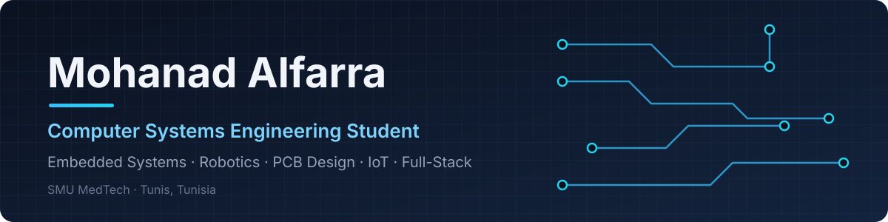

  

  
  
  

## 👋 About me

I'm a **Computer Systems Engineering** student at **SMU MedTech** (Tunis, since 2023).
I design custom circuit boards, write real-time firmware, and bring sensors, motors and
microcontrollers together into robotic and embedded systems that actually work.

- 🔧 **Focus:** embedded systems, robotics, PCB design, IoT and automation
- 💼 **Experience:** full-stack internship at **Tunisie Telecom** · monitoring internship at **Prologic Tunisie**
- 🌍 **Languages:** English · French · Arabic · Spanish
- 📫 **Open to:** internships and engineering projects

> *"I don't just want to become an engineer. I want to turn ideas into things that actually work."*

---

## 🚀 Featured projects

| Project | What it is | Stack |
|---|---|---|
| 🤖 **[DEXTER](https://github.com/mohanadfarra/dexter-robotics-platform)** | Modular educational robot on a **custom 2-layer PCB**. Two ESP32-S3 boards: one for vision & Wi-Fi, one for jitter-free 50 Hz motor control. | ESP32-S3 · Altium · IMU · Embedded C |
| 🗄️ **[TT Network Inventory](https://github.com/mohanadfarra/tt-network-inventory)** | Full-stack web app to track network equipment, built during my Tunisie Telecom internship. JWT login, role-based access, Docker. | Node.js · Express · PostgreSQL · Docker |
| ⚡ **[PromptWATT-Lite](https://github.com/mohanadfarra/promptwatt-lite)** | Two-channel DC power monitor: real-time voltage/current/power with a web dashboard and AI-assisted load control. | STM32 · ESP32 · Sensors · LLM tools |
| 🌧️ **[Go-Ma](https://github.com/mohanadfarra/go-ma-flood-warning)** | Solar-powered stormwater-drain overflow warning over private LoRa — works when power and Internet fail. *IEEE TSYP14 challenge.* | ESP32 · LoRa · 4–20 mA · Raspberry Pi |
| ☀️ **[DustCast](https://github.com/mohanadfarra/dustcast-solar-forecast)** | National rooftop-solar forecasting platform for Tunisia, district → governorate → nation. *IEEE PES TGM challenge.* | Forecasting · Data · Dashboard |
| 🥤 **[BMO](https://github.com/mohanadfarra/bmo-smart-vending-machine)** | IoT smart vending machine with QR access, cashless payment and a manager dashboard. | Raspberry Pi · ESP32 · RFID · PHP · MySQL |
| ❤️ **[Heart Disease Prediction](https://github.com/mohanadfarra/heart-disease-ml-pipeline)** | ML pipeline on 1,025 patient records. Random Forest reaches **93.2 % accuracy**. | Python · scikit-learn · pandas |
| 🃏 **[Chroma Clash](https://github.com/mohanadfarra/chroma-clash)** | Multiplayer card game with a clean game / backend / UI split, ready for TCP/UDP networking. Unit-tested. | Python · Tkinter · Sockets |

---

## 🛠️ Tech stack

**Embedded & hardware** 

**Languages** 

**Web, data & infrastructure** 

---

## 💼 Experience

**Tunisie Telecom** — *Full-Stack Developer Intern* · Jun – Jul 2026 
Built a web app to track network equipment and IT hardware: REST API with Node.js, Express and PostgreSQL, JWT + bcrypt authentication, admin/consultant roles, Docker packaging.

**Prologic Tunisie** — *IT Monitoring & Observability Intern* · Jun – Jul 2025 
Designed Zabbix and Grafana dashboards for server health (CPU, RAM, disk, network, availability), configured agents, email alerts and automated PDF reports.

---

## 🏆 Competitions & leadership

- ☀️ **IEEE PES Tunisia General Meeting** — National Solar Challenge, 5-member MedTech team (DustCast)
- 🌧️ **IEEE TSYP14 · NEXUS Technical Challenge** — Go-Ma flood early-warning system, team of 4
- 🧑‍🤝‍🧑 **IEEE SMU PES · IAS · IES Joint Chapter** — Human Resources Board Member
- 🤖 **IEEE Robotics & Automation Society** — Chapter member (2024 – present)
- 🦁 **Lions Club Tunis SMU** — Community service member (2025 – present)
- 📜 **Coursera & Duke University** — Certificates in Java, Python and C programming

---

📍 Tunis, Tunisia · Always happy to talk about internships, projects or anything engineering.

